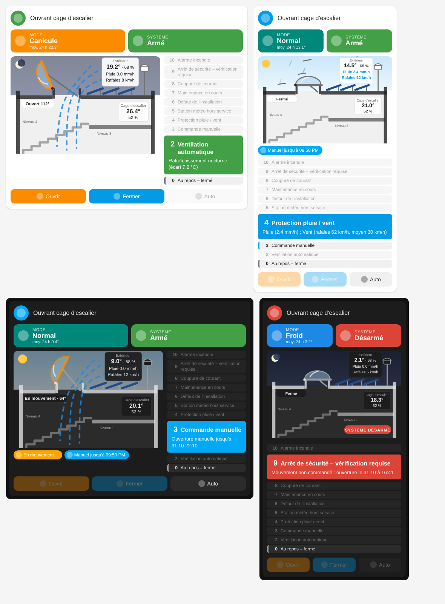

# Ventilation désenfumage

Intégration Home Assistant pour piloter la **ventilation** d'une cage d'escalier
avec l'ouvrant d'une centrale de désenfumage **D+H CPS-B1**, via deux **Shelly 1 Gen4**
(contacts secs sur X3) et un capteur d'ouverture **Shelly BLU Door/Window**.

Inspirée du pipeline de décision d'Adaptive Cover Pro : chaque niveau est évalué
du plus prioritaire au moins prioritaire, le premier actif gagne, et la trace
complète est visible dans le dashboard.

> ⚠️ L'intégration ne commande que la **ventilation de confort**. La fonction de
> désenfumage reste entièrement gérée par la centrale, qui garde toujours la priorité.

## Pipeline de décision

Les boutons **Ouvrir / Fermer** sont refusés à partir du niveau 4 (et grisés dans la carte).
Pour les automatisations, comparer l'attribut `cle` du capteur de décision plutôt que son texte.

| Prio | Niveau | Condition | Action |
|---:|---|---|---|
| 10 | Alarme incendie | Entrée SW du Shelly A active (relais X2.5) | Aucun ordre, désarmement |
| 9 | Arrêt de sécurité – vérification requise | Mouvement non commandé, alarme, ou désarmement manuel | Aucun ordre jusqu'au réarmement |
| 8 | Coupure de courant | Les deux Shelly hors ligne **et** onduleur sur batterie | Attente (la centrale ferme, S1.6) |
| 7 | Maintenance en cours | Les deux Shelly hors ligne, secteur présent (interrupteur à clé) | Attente |
| 6 | Défaut de l'installation | Entrée SW du Shelly B inactive (relais X2.8 ouvert) ou un seul Shelly hors ligne | Fermer + notification |
| 5 | Station météo hors service | Température, pluie ou rafales indisponibles ou trop anciennes | Fermer |
| 4 | Protection pluie / vent | Pluie (+ attente de séchage), vent / rafales (+ attente), risque de précipitations | Fermer |
| 3 | Commande manuelle | Bouton OUVRIR / FERMER du dashboard | Respectée pendant la durée réglée |
| 2 | Ventilation automatique | Selon le mode saisonnier (voir ci-dessous) | Ouvrir + maintien |
| 0 | Au repos – fermé | — | Fermer |

### Modes saisonniers (température extérieure moyenne sur 24 h)

| Mode | Moyenne | Comportement |
|---|---|---|
| Froid | < 5 °C | Pas d'ouverture automatique |
| Normal | 5 – 20 °C | Aération quotidienne à heure fixe (10 min par défaut) |
| Canicule | > 20 °C | Ventilation nocturne dès le coucher du soleil (+ décalage), pendant la durée max, jusqu'au lever du soleil au plus tard, **seulement si l'intérieur est plus chaud que l'extérieur** d'au moins l'écart réglé et au-dessus de la température min. Arrêt dès que la cible intérieure est atteinte. |

Les seuils et l'hystérésis (1 °C par défaut) sont réglables. Le mode peut aussi être
imposé (sélecteur « Choix du mode »).

### Commande de l'ouvrant

- Impulsion d'environ 1 s sur le Shelly concerné, jamais OUVRIR et FERMER en même temps.
- Tant que l'ouverture est demandée, une impulsion OUVRIR est renvoyée toutes les 5 min
  pour relancer la temporisation de la centrale (S2.3, 10 min). Si Home Assistant ou le
  réseau tombe, la centrale referme d'elle-même.
- En mode normal (10 min), une seule impulsion suffit : la centrale referme seule.
- Si l'ouvrant reste ouvert alors que la fermeture est demandée, l'ordre FERMER est
  répété (3 fois max), puis une notification est créée.

### Mouvements non commandés

Un changement d'état du capteur d'ouverture est classé :

- **attendu** : dans le temps de course après une impulsion de Home Assistant ;
- **temporisation** : fermeture environ 10 min après la dernière impulsion OUVRIR (S2.3).
  Notification si l'ouverture était encore demandée (le maintien ne fonctionne pas) ;
- **inconnu** : sinon (ouverture pompier, bouton de maintenance sans interrupteur à clé…).
  Le système est **désarmé** et doit être réarmé par un utilisateur autorisé.

Les changements sont ignorés pendant le délai de resynchronisation qui suit le démarrage
de Home Assistant ou le retour des Shelly (fin de maintenance ou de coupure).

## Cycle de vie du moteur

| Capteur | Ce qui est compté |
|---|---|
| Nombre d'ouvertures / de fermetures | Mouvements **réels** vus par le capteur d'ouverture, quelle que soit leur origine (Home Assistant, bouton de maintenance, alarme). Un mouvement fait pendant que le capteur était indisponible est compté à son retour. |
| Impulsions OUVRIR / FERMER envoyées | Ordres envoyés par Home Assistant (y compris les impulsions de maintien). |

Les compteurs sont conservés après un redémarrage. Le bouton « Remise à zéro des
compteurs » (après un remplacement du moteur) est réservé aux utilisateurs autorisés ;
la date de départ est indiquée dans l'attribut `depuis`. Le dashboard affiche aussi un
graphique des ouvertures par mois.

## Installation

### Via HACS (dépôt personnalisé)

1. HACS > ⋮ > Dépôts personnalisés > `https://github.com/lutchage/ventilation-desenfumage`, catégorie « Intégration ».
2. Installer « Ventilation désenfumage », redémarrer Home Assistant.

### Manuellement

Copier `custom_components/ventilation_desenfumage/` dans `config/custom_components/`,
puis redémarrer Home Assistant.

### Configuration

Paramètres > Appareils et services > Ajouter une intégration > « Ventilation désenfumage ».
Choisir :

| Champ | Entité |
|---|---|
| Shelly A – relais OUVRIR | `switch` du Shelly A |
| Shelly B – relais FERMER | `switch` du Shelly B |
| Entrée SW du Shelly A | `binary_sensor` d'entrée du Shelly A (alarme) |
| Entrée SW du Shelly B | `binary_sensor` d'entrée du Shelly B (défaut, contact NF) |
| Capteur d'ouverture | `binary_sensor` du BLU Door/Window |
| Angle (optionnel) | capteur d'inclinaison du BLU Door/Window |
| Température / humidité cage | BLU H&T |
| Température extérieure, pluie, rafales, vent | WS90 |
| Risque de précipitations (optionnel) | tout capteur en % |
| État de l'onduleur | `binary_sensor` (on = sur batterie) ou capteur texte (NUT : « OB », « On Battery »…) |

Ensuite, dans **Configurer** (options techniques) : choisir les **utilisateurs autorisés**
à armer / désarmer (vide = administrateurs uniquement) et vérifier les durées.

### Préparation des Shelly

- Alimentation 24 V DC : **+ sur N, – sur L**.
- Relais : **auto-off 1 s** sur les deux Shelly (sécurité supplémentaire).
- Entrées SW : mode **détaché** (sinon elles commanderaient le relais).
- Comportement au démarrage : **relais OFF**.
- Activer la passerelle Bluetooth pour le BLU Door/Window et le BLU H&T.

## Dashboard

Le fichier `dashboard/ventilation_dashboard.yaml` contient un tableau de bord prêt à
l'emploi (vue « Ouvrant » + vue « Réglages »). Remplacer les lignes marquées
`# À ADAPTER` par vos entités et les identifiants des utilisateurs autorisés.

## Carte graphique

L'intégration fournit sa propre carte, chargée automatiquement dans Home Assistant
(aucune ressource à ajouter) :

```yaml
type: custom:ventilation-desenfumage-card
entity: sensor.ventilation_desenfumage_decision
title: Ouvrant cage d'escalier   # optionnel
show_pipeline: true              # optionnel : barre des 10 niveaux
show_buttons: true               # optionnel : boutons Ouvrir / Fermer / Auto
```



La carte comprend :

- **deux grandes pastilles** : le mode saisonnier (Froid / Normal / Canicule, avec la moyenne
  24 h) et l'état du système (Armé / Désarmé) ;
- **la coupe de l'immeuble** (milieu du niveau 3 jusqu'au toit plat) avec l'escalier, les
  panneaux solaires, le mât de la WS90 et la coupole à son angle réel, le flux d'air, la pluie
  et le vent animés, le jour ou la nuit ; l'étiquette « Extérieur » regroupe température,
  humidité, pluie et rafales ;
- **l'échelle des 10 niveaux**, verticale à droite du schéma (dessous sur téléphone) :
  le niveau actif est agrandi et affiche sa raison ;
- **les boutons Ouvrir / Fermer / Auto** : Ouvrir et Fermer sont grisés quand le système est
  désarmé, à partir du niveau 4, ou **pendant le mouvement de l'ouvrant**.

Un clic sur un élément ouvre la fiche de l'entité. En cas d'alarme, le cadre clignote en rouge.

### Détection du mouvement

L'ouvrant est considéré en mouvement si l'angle du capteur BLU Door a varié depuis moins
de 8 s (réglable, le capteur envoie l'angle toutes les 3 à 5 s pendant la course), ou si une
impulsion vient d'être envoyée et que la position finale n'est pas encore atteinte (au plus
le temps de course). Pendant ce temps, Ouvrir et Fermer sont refusés. Le capteur binaire
« Ouvrant en mouvement » expose cet état.

Les autres entités sont trouvées automatiquement grâce à l'attribut `entites` du
capteur de décision.

## Événements

Chaque événement important déclenche l'événement Home Assistant
`ventilation_desenfumage_event` (`type`, `message`), utilisable pour envoyer une
notification sur mobile :

```yaml
triggers:
  - trigger: event
    event_type: ventilation_desenfumage_event
    event_data:
      type: desarme
actions:
  - action: notify.mobile_app_mon_telephone
    data:
      title: Ventilation cage d'escalier
      message: "{{ trigger.event.data.message }}"
```

Types : `desarme`, `arme`, `defaut`, `temporisation`, `fermeture`, `manuel`, `mode`, `decision`.

## Tests à faire à la mise en service

1. **Temporisation S2.3** : ouvrir, renvoyer OUVRIR après 5 min, vérifier que la
   fermeture a lieu 10 min après la *deuxième* impulsion.
2. Bouton de maintenance avec interrupteur à clé sur ARRÊT : niveau « Maintenance »,
   pas de désarmement.
3. Bouton de maintenance avec interrupteur à clé sur MARCHE : désarmement.
4. Couper le 230 V de la centrale : niveau « Coupure secteur », fermeture par la centrale.
5. Déclencher une alarme avec l'entreprise de maintenance : niveau « Alarme », aucun ordre.
6. Débrancher la WS90 : niveau « Panne station météo » après le délai réglé.

## Icône

L'icône est fournie dans `custom_components/ventilation_desenfumage/brand/` (versions claire et sombre). Home Assistant l'affiche automatiquement à partir de la version 2026.3. La source vectorielle est dans `images/icon.svg`.

## Licence

MIT – voir [LICENSE](LICENSE).
